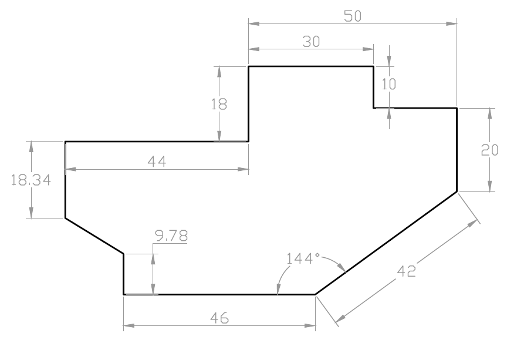
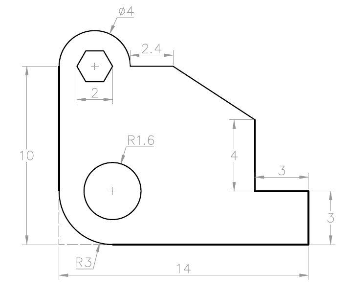
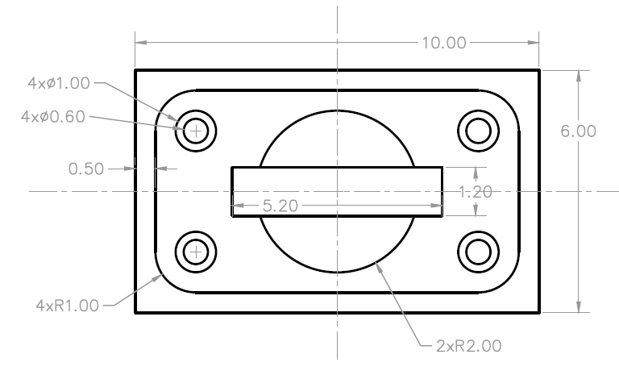
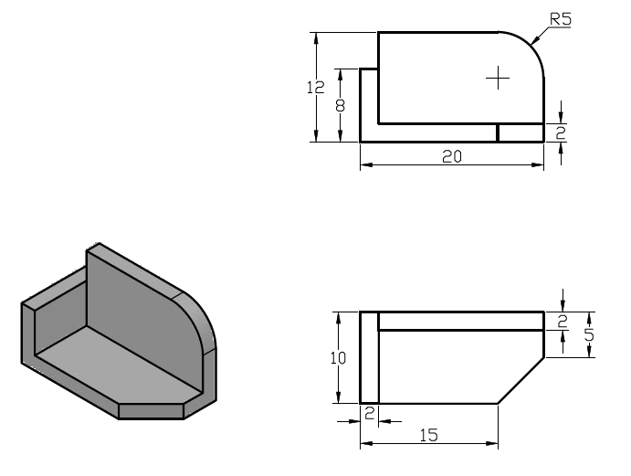
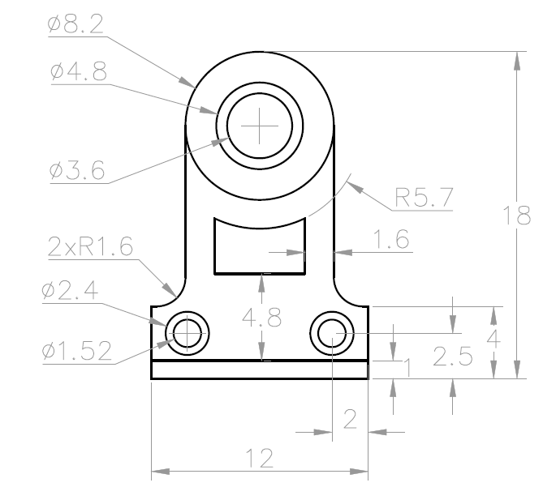
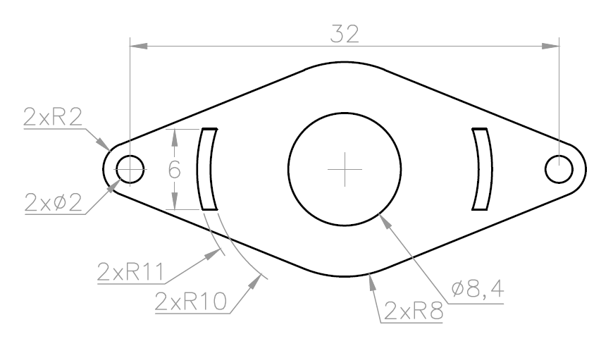
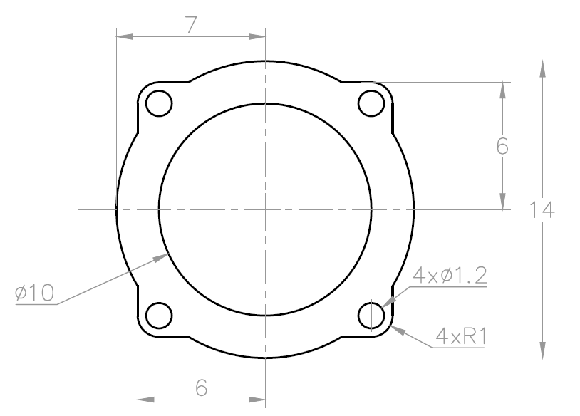
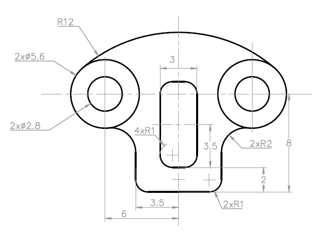
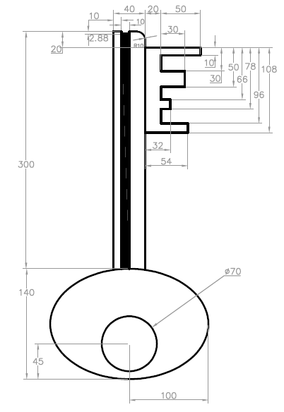

# WSQ Technical Drawing with AutoCAD — Learner Guide

**WSQ Course Code:** TGS-2021005538  |  **Conducted by:** Tertiary Infotech Academy Pte Ltd (UEN 201200696W)  |  **Version v13 · 21 August 2026**

## Contents

- [Introduction](#introduction)
- [Course Learning Outcomes](#course-learning-outcomes)
- [Before You Start — Environment Setup](#before-you-start--environment-setup)
- [Topic 01 — Getting Started with AutoCAD  (A1 · K1)](#topic-01--getting-started-with-autocad--a1--k1)
  - [Lab 1 — Setting Up a New Drawing](#lab-1--setting-up-a-new-drawing)
- [Topic 02 — Technical Drawing with AutoCAD  (A2 · K2)](#topic-02--technical-drawing-with-autocad--a2--k2)
  - [Lab 2 — Creating Lines and Coordinates](#lab-2--creating-lines-and-coordinates)
  - [Lab 3 — Circles, Rectangles and Polygons](#lab-3--circles-rectangles-and-polygons)
  - [Lab 4 — Polylines, Arcs, Ellipses and Splines](#lab-4--polylines-arcs-ellipses-and-splines)
  - [Lab 5 — 2D Isometric Drawing](#lab-5--2d-isometric-drawing)
- [Topic 03 — Modifying Objects  (A3 · K3)](#topic-03--modifying-objects--a3--k3)
  - [Lab 6 — Move, Copy, Rotate and Offset](#lab-6--move-copy-rotate-and-offset)
  - [Lab 7 — Trim, Extend, Fillet and Chamfer](#lab-7--trim-extend-fillet-and-chamfer)
  - [Lab 8 — Mirror, Stretch, Scale and Arrays](#lab-8--mirror-stretch-scale-and-arrays)
- [Topic 04 — Organizing Objects  (A4 · K4)](#topic-04--organizing-objects--a4--k4)
  - [Lab 9 — Object Properties and Layers](#lab-9--object-properties-and-layers)
  - [Lab 10 — Grips, Hide and Isolate](#lab-10--grips-hide-and-isolate)
  - [Lab 11 — Blocks, Attributes and Part Lists](#lab-11--blocks-attributes-and-part-lists)
  - [Lab 12 — External References and PDF Import](#lab-12--external-references-and-pdf-import)
- [Topic 05 — Design Documentation  (A5 · K5)](#topic-05--design-documentation--a5--k5)
  - [Lab 13 — Text and Text Styles](#lab-13--text-and-text-styles)
  - [Lab 14 — Dimensions, Multileaders and Part-List Tables](#lab-14--dimensions-multileaders-and-part-list-tables)
  - [Lab 15 — Hatching and Detail Finishing](#lab-15--hatching-and-detail-finishing)
  - [Lab 16 — Layouts, Viewports and Plotting](#lab-16--layouts-viewports-and-plotting)
- [Reading Technical Drawings — Quick Reference](#reading-technical-drawings--quick-reference)
- [Preparing for the Assessment](#preparing-for-the-assessment)
- [Glossary](#glossary)


## Introduction

This Learner Guide accompanies the WSQ course WSQ Technical Drawing with AutoCAD (TGS-2021005538), conducted by Tertiary Infotech Academy Pte Ltd. It provides step-by-step instructions for all 16 hands-on labs, organised by the five course topics, aligned to the Skills Framework TSC Technical Drawing (DSN-TDR-3005-1.11).

Use this guide alongside the course slides and the lab folders in labs/ of the course repository. Each lab folder contains this guide's instructions as README.md, a printable PDF instruction sheet, and the AutoCAD DWG data files for that lab. The final assessment is open book: you may refer to the slides, this Learner Guide and other approved materials.


## Course Learning Outcomes

- LO1: Read and visualize AutoCAD technical drawings
- LO2: Produce 2D and 3D technical drawings using AutoCAD
- LO3: Create part lists using AutoCAD
- LO4: Create AutoCAD design documentation
- LO5: Produce design specification using AutoCAD


## Before You Start — Environment Setup

**What you need**

- A Windows PC (or Mac) with AutoCAD installed — AutoCAD 2021 or later (any recent release works; the free 30-day trial or an education licence is fine).
- Download AutoCAD from https://www.autodesk.com/products/autocad/free-trial or the education community at https://www.autodesk.com/education.
- The course lab files — the labs/ folder of the course repository (one folder per lab: DWG data files, PDF instruction sheet and README).
- A mouse with a scroll wheel — zooming and panning with the wheel is essential for CAD work.

**Set up AutoCAD for the course**

- Start AutoCAD and choose the Drafting & Annotation workspace.
- New drawings in this course start from the metric template acadiso.dwt.
- Keep the status bar visible — grid, snap, ortho, polar tracking and object snap are used in every lab.
- Copy the labs/ folder to your Documents so you can open and save the lab drawings freely.

**Conventions used in every lab**

- Commands are typed at the command line or picked from the ribbon; the short alias is shown in brackets, e.g. LINE (L).
- The → arrow chains a command's prompts, e.g. 'C → D → 40' means run CIRCLE, choose Diameter, type 40.
- Coordinates: absolute 100,50 · relative @50,0 · polar @50<30.
- Save your work as <lab>-mine.dwg so the supplied solution files stay untouched.
- Every lab ends with a 'Check your work' test — verify before moving on.


## Topic 01 — Getting Started with AutoCAD  (A1 · K1)

AutoCAD User Interface · Workspace Settings · Navigation · Units

**Key concepts**

- User interface — Application menu, Quick Access Toolbar, ribbon tabs and panels, drawing area, command window and status bar.
- Workspaces — Drafting & Annotation, 3D Basics and 3D Modeling — task-oriented sets of ribbons, menus and palettes.
- Model vs paper space — Design at 1:1 in model space; compose scaled drawing sheets in paper-space layouts.
- Precision aids — Grid and snap, ortho mode, polar tracking, object snaps and dynamic input keep every pick exact.
- Navigation — Zoom, pan, ViewCube and the wheel mouse move you around a drawing without changing it.
- Units and limits — UNITS sets the length/angle format and precision; LIMITS frames the working area of the drawing.


### Lab 1 — Setting Up a New Drawing

Objective: LO1 — read and visualize AutoCAD technical drawings; set up a drawing environment (A1, K1).

Goal: Create and verify a metric drawing environment, compare saved workspace and drafting-setting examples, then open a finished drawing and practise reading it with zoom, pan and ViewCube.

**You'll produce**

A correctly configured metric drawing saved as DWG, a settings audit, and confident navigation of an existing technical drawing.   (Commands: ACADISO template, UNITS, LIMITS, DSETTINGS, WSCURRENT, ZOOM, PAN, ViewCube.)

**Step-by-step**

1. Start AutoCAD and create a new drawing from the ISO metric template

   ```
   NEW → acadiso.dwt
   ```

2. Open workspaces.dwg, compare the available workspaces, then switch to Drafting & Annotation

   ```
   OPEN workspaces.dwg → WSCURRENT → Drafting & Annotation
   ```

3. Set decimal millimetres with 0.00 precision and decimal degrees for angles

   ```
   UNITS → Insertion scale: Millimetres → Length: Decimal, 0.00
   ```

4. Frame an A3-sized working area with drawing limits, then zoom to it

   ```
   LIMITS → 0,0 → 420,297  |  ZOOM → All
   ```

5. Open drafting-settings.dwg and audit grid, snap, ortho, polar and object-snap settings

   ```
   OPEN drafting-settings.dwg → DSETTINGS · F7 · F9 · F8 · F10 · F3
   ```

6. Open lab01-table.dwg and navigate it: wheel-zoom, pan, zoom window and zoom extents

   ```
   OPEN lab01-table.dwg → Z → W / Z → E
   ```

7. Identify the views, dimensions and title information in the drawing, then save your setup file

   ```
   SAVEAS → lab01-setup.dwg
   ```


**Check your work**

INSUNITS reports millimetres, limits are 420 × 297, Drafting & Annotation is current, the precision-aid audit is complete, and lab01-setup.dwg reopens with the settings intact.

> **Note:** This lab's data files and printable instructions are in labs/lab-01-setting-up-a-new-drawing/.

---


## Topic 02 — Technical Drawing with AutoCAD  (A2 · K2)

Basic AutoCAD Operations · Drawing Objects · Isometric Drawing

**Key concepts**

- Lines & polylines — LINE draws separate segments; PLINE creates one connected object of line and arc segments.
- Circles & arcs — Circles by centre/radius or diameter; arcs by combinations of start, centre, end, radius and angle.
- Rectangles & polygons — RECTANG builds closed rectangular polylines; POLYGON draws 3–1024-sided regular polygons.
- Ellipses, splines & points — Ellipses from axis endpoints; splines as smooth curves through fit points; points as snap nodes.
- Construction geometry — Construction lines (XLINE) and rays give infinite reference lines for projecting views.
- 2D isometric drawing — ISODRAFT turns on isometric planes so a flat drawing represents a 3D projection.


### Lab 2 — Creating Lines and Coordinates

Objective: LO2 — produce 2D technical drawings using AutoCAD (A2, K2).

Goal: Draw the outline of practice drawing EX-1 using the LINE and PLINE commands with absolute, relative and polar coordinate entry, working from its dimensioned drawing sheet.



*Lab 2 — the drawing you'll produce*

**You'll produce**

The completed EX-1 profile drawn to size, matching the supplied solution DWG.   (Commands: LINE, PLINE, coordinate entry (@dx,dy · @dist<angle), ORTHO, dynamic input.)

**Step-by-step**

1. Open the EX-1 drawing sheet (ex1-drawing-sheet.pdf) and study the dimensions
2. Start a new acadiso drawing and draw the first edge with absolute coordinates

   ```
   L → 0,0 → 100,0
   ```

3. Continue the profile with relative coordinates for each dimensioned edge

   ```
   @0,50  ·  @-30,0  ·  @20<135
   ```

4. Use ortho (F8) and polar tracking (F10) for the horizontal and vertical segments

   ```
   F8 · F10
   ```

5. Close the profile back to the start point and check it forms one closed loop

   ```
   C (Close)
   ```

6. Compare your result against the solution file ex1.dwg, then save

   ```
   OPEN ex1.dwg → SAVEAS ex1-mine.dwg
   ```


**Check your work**

Your outline closes exactly (LIST shows the final vertex at 0,0) and overlays the solution ex1.dwg with no visible deviation.

> **Note:** This lab's data files and printable instructions are in labs/lab-02-creating-lines-and-coordinates/.

---


### Lab 3 — Circles, Rectangles and Polygons

Objective: LO2 — produce 2D technical drawings using AutoCAD (A2, K2).

Goal: Complete practice drawing EX-2 by adding circles (centre-radius, diameter, 2P/3P and Tan-Tan-Radius), a rectangle with chamfered/filleted corners and inscribed/circumscribed polygons.



*Lab 3 — the drawing you'll produce*

**You'll produce**

The completed EX-2 drawing with all holes, rectangles and polygons placed to the sheet dimensions.   (Commands: CIRCLE (Cen-Rad, 2P, 3P, TTR), RECTANG, POLYGON, object snaps.)

**Step-by-step**

1. Open the EX-2 sheet (ex2-drawing-sheet.pdf) and identify each hole's centre
2. Draw the main circles by centre point and radius, snapping to intersections

   ```
   C → cen point → 25
   ```

3. Add a circle by diameter and one through two points on existing geometry

   ```
   C → D → 40  ·  C → 2P
   ```

4. Draw a tangent-tangent-radius circle touching two existing circles

   ```
   C → TTR → pick 2 tangents → radius
   ```

5. Create the rectangle feature, then a hexagon inscribed in a 30-radius circle

   ```
   REC → corner → @80,50  ·  POL → 6 → I → 30
   ```

6. Verify against the solution ex2.dwg and save your drawing

   ```
   SAVEAS ex2-mine.dwg
   ```


**Check your work**

Every circle's centre and radius match the sheet (use LIST), the hexagon has 6 equal sides, and your drawing overlays ex2.dwg cleanly.

> **Note:** This lab's data files and printable instructions are in labs/lab-03-circles-rectangles-and-polygons/.

---


### Lab 4 — Polylines, Arcs, Ellipses and Splines

Objective: LO2 — produce 2D technical drawings using AutoCAD (A2, K2).

Goal: Draw practice drawing EX-3 combining polylines with arc segments, standalone arcs, an ellipse and a spline, plus construction lines to project feature positions between views.



*Lab 4 — the drawing you'll produce*

**You'll produce**

The completed EX-3 drawing with mixed line/arc geometry drawn as clean, connected objects.   (Commands: PLINE (Arc mode), ARC, ELLIPSE, SPLINE, XLINE, POINT/DIVIDE.)

**Step-by-step**

1. Open the EX-3 sheet (ex3-drawing-sheet.pdf) and plan the outline as one polyline
2. Draw the outline with PLINE, switching between Line and Arc segments as you go

   ```
   PL → pick → A (arc) → L (line)
   ```

3. Place construction lines to project the centres of features between views

   ```
   XL → H / V through centres
   ```

4. Add a three-point arc and a centre-start-end arc where the sheet shows open curves

   ```
   A → 3 points  ·  A → C
   ```

5. Draw the ellipse from its axis endpoints and a smooth spline through the fit points

   ```
   EL → axis ends → half-width  ·  SPL
   ```

6. Compare with ex3.dwg, purge the construction lines and save

   ```
   ERASE xlines → SAVEAS ex3-mine.dwg
   ```


**Check your work**

The outline is a single polyline (one object when selected), arcs and the ellipse match the sheet dimensions, and no construction lines remain in the final drawing.

> **Note:** This lab's data files and printable instructions are in labs/lab-04-polylines-arcs-ellipses-and-splines/.

---


### Lab 5 — 2D Isometric Drawing

Objective: LO2 — produce 2D and 3D technical drawings using AutoCAD (A2, K2).

Goal: Use ISODRAFT to create a 2D isometric representation of the 3D object supplied in iso-object.dwg, switching isoplanes and drawing isocircles for the round features.



*Lab 5 — the drawing you'll produce*

**You'll produce**

A flat isometric drawing of the 3D object — edges on the three isoplanes plus isocircle holes.   (Commands: ISODRAFT, isoplanes (F5), ELLIPSE Isocircle, polar tracking.)

**Step-by-step**

1. Open the object sheet iso-object-sheet.pdf and identify its three faces
2. Turn on isometric drafting from the status bar and set the Top isoplane

   ```
   ISODRAFT → Isoplane Top (F5)
   ```

3. Draw the top face edges along the 30°/150° isometric axes with polar tracking

   ```
   L with polar 30°/150°
   ```

4. Switch to the Right and Left isoplanes and complete the vertical faces

   ```
   F5 → Right · F5 → Left
   ```

5. Add the round features as isocircles on the correct isoplane

   ```
   EL → I (Isocircle) → centre → radius
   ```

6. Compare your isometric with the 3D model in iso-object.dwg and save

   ```
   SAVEAS iso-mine.dwg
   ```


**Check your work**

Each face lies on the correct isoplane (edges at 30°/90°/150°), the isocircles read as ellipses aligned to their faces, and the drawing matches the supplied object's proportions.

> **Note:** This lab's data files and printable instructions are in labs/lab-05-2d-isometric-drawing/.

---


## Topic 03 — Modifying Objects  (A3 · K3)

Move · Copy · Rotate · Offset · Mirror · Trim · Fillet · Arrays

**Key concepts**

- Relocate & duplicate — MOVE, COPY and ROTATE reposition objects from a base point to a second point or angle.
- Offset & mirror — OFFSET creates parallel copies at a set distance; MIRROR reflects half a symmetric design.
- Trim & extend — Quick and Standard modes cut objects back to, or extend them to meet, boundary edges.
- Fillet & chamfer — FILLET rounds a corner with a radius; CHAMFER bevels it with distances or an angle.
- Arrays — Rectangular, polar and path arrays distribute copies in rows/columns, around a centre, or along a curve.
- Stretch, scale & explode — STRETCH lengthens with a crossing window; SCALE resizes about a base point; EXPLODE breaks compounds.


### Lab 6 — Move, Copy, Rotate and Offset

Objective: LO2/LO3 — modify 2D drawings efficiently to build up a design (A3, K3).

Goal: Build practice drawing EX-4 by drawing one feature and then positioning the rest with MOVE, COPY (multiple), ROTATE with reference angle and OFFSET for the parallel profiles.



*Lab 6 — the drawing you'll produce*

**You'll produce**

The completed EX-4 drawing produced with modify commands rather than re-drawing each feature.   (Commands: MOVE, COPY (Multiple/Array), ROTATE (Reference), OFFSET.)

**Step-by-step**

1. Open the EX-4 sheet (ex4-drawing-sheet.pdf) and spot the repeated features
2. Draw the base profile, then offset it to create the parallel inner/outer edges

   ```
   O → distance → pick side
   ```

3. Draw one hole feature and copy it to every dimensioned centre

   ```
   CO → base point → second points
   ```

4. Move a mis-placed feature precisely from its centre to the correct intersection

   ```
   M → base → destination
   ```

5. Rotate the angled feature about its base point, using Reference to match the sheet angle

   ```
   RO → base → R → ref angle → new angle
   ```

6. Check against ex4.dwg and save your version

   ```
   SAVEAS ex4-mine.dwg
   ```


**Check your work**

Feature spacings measure correct with DIST, offsets are at the specified distances, and the rotated feature sits at exactly the sheet's angle.

> **Note:** This lab's data files and printable instructions are in labs/lab-06-move-copy-rotate-and-offset/.

---


### Lab 7 — Trim, Extend, Fillet and Chamfer

Objective: LO2/LO3 — clean up and finish drawing geometry (A3, K3).

Goal: Complete practice drawing EX-5 by trimming overlapping construction geometry, extending short edges to their boundaries, and finishing corners with fillets and chamfers.



*Lab 7 — the drawing you'll produce*

**You'll produce**

A clean EX-5 profile with every corner finished exactly as dimensioned on the sheet.   (Commands: TRIM (Quick/Standard), EXTEND, FILLET, CHAMFER, BREAK.)

**Step-by-step**

1. Open the EX-5 sheet (ex5-drawing-sheet.pdf) and rough out the profile with overlapping lines
2. Trim the overshoots in Quick mode — click or drag across the pieces to remove

   ```
   TR → click segments
   ```

3. Use Standard mode where you need explicit cutting edges: select boundaries, then objects

   ```
   TR → Enter (all edges) → pick
   ```

4. Extend the short edges to meet their boundary lines

   ```
   EX → pick edges to extend
   ```

5. Fillet the rounded corners at the sheet radius, and chamfer the bevelled ones

   ```
   F → R → 10 → pick 2 lines  ·  CHA → D → 5,5
   ```

6. Compare with ex5.dwg and save

   ```
   SAVEAS ex5-mine.dwg
   ```


**Check your work**

No overshooting or dangling segments remain (zoom around the whole profile), and every fillet radius / chamfer distance matches the drawing sheet.

> **Note:** This lab's data files and printable instructions are in labs/lab-07-trim-extend-fillet-and-chamfer/.

---


### Lab 8 — Mirror, Stretch, Scale and Arrays

Objective: LO2/LO3 — reproduce patterned and symmetric geometry (A3, K3).

Goal: Produce practice drawing EX-6 with mirror, stretch, scale and arrays, then inspect the supplied sawblade drawing to reverse-engineer a production polar-array pattern.



*Lab 8 — the drawing you'll produce*

**You'll produce**

The completed EX-6 drawing plus a verified sawblade polar array with the correct centre, item count, fill angle and associative state.   (Commands: MIRROR, STRETCH (crossing window), SCALE (Reference), ARRAYRECT, ARRAYPOLAR.)

**Step-by-step**

1. Open the EX-6 sheet (ex6-drawing-sheet.pdf) and find its axis of symmetry
2. Draw one half of the outline, then mirror it across the centreline

   ```
   MI → select → axis pt1 → pt2 → N
   ```

3. Array one hole into the rectangular pattern (rows, columns, spacing from the sheet)

   ```
   AR → R → rows/cols/spacing
   ```

4. Distribute the bolt holes around the centre with an associative polar array

   ```
   AR → PO → centre → items → 360 → Associative: Yes
   ```

5. Stretch the slot to its dimensioned length with a crossing window, scale a feature with Reference

   ```
   S → crossing → base → distance  ·  SC → R
   ```

6. Open sawblade.dwg, select its tooth array and record centre, item count, fill angle and associativity

   ```
   OPEN sawblade.dwg → select array → PR
   ```

7. Verify against ex6.dwg and save

   ```
   SAVEAS ex6-mine.dwg
   ```


**Check your work**

The two halves are symmetric, array counts and spacings match the sheet, the slot length is correct, and you can explain the four defining properties of the sawblade polar array.

> **Note:** This lab's data files and printable instructions are in labs/lab-08-mirror-stretch-scale-and-arrays/.

---


## Topic 04 — Organizing Objects  (A4 · K4)

Object Properties · Layers · Blocks, Attributes & Reusable Content

**Key concepts**

- Object properties — Colour, linetype and lineweight — set ByLayer and inspected in the Properties palette (PR).
- Layers — The primary method of organising a drawing by function; control on/off, freeze/thaw, lock and plot.
- Grips — Multi-functional grips stretch, move, rotate, scale and copy objects without typing a command.
- Hide & isolate — Temporarily isolate the objects you are working on and hide the rest of the drawing.
- Blocks & attributes — Blocks are reusable symbols; attributes attach part numbers and data — the basis of part lists.
- External references — Xrefs attach another drawing (or PDF underlay) so teams share one live reference file.


### Lab 9 — Object Properties and Layers

Objective: LO3/LO4 — organise a drawing with layers and properties (A4, K4).

Goal: Create a standards-based layer scheme in lab-table-lesson2.dwg, then audit the supplied office-plan-ground-floor.dwg to see how a larger architectural drawing separates systems.

**You'll produce**

A layered table drawing where every object is ByLayer, plus a five-layer audit of the office plan covering naming, colour, linetype, lineweight and plot state.   (Commands: LAYER (LA), Properties palette (PR), Layer Walk, MATCHPROP, freeze/thaw, lock.)

**Step-by-step**

1. Open lab-table-lesson2.dwg and inspect current object properties

   ```
   PR (Properties palette)
   ```

2. Create layers: A-OUTLINE, A-HIDDEN, A-CENTRE, A-DIMS, A-TEXT with colours and linetypes

   ```
   LA → New Layer → colour/linetype
   ```

3. Load the HIDDEN and CENTER linetypes and set lineweights per layer

   ```
   LA → Linetype → Load → HIDDEN, CENTER
   ```

4. Select objects by type and move them to their layers; copy formatting with MATCHPROP

   ```
   select → Layer drop-down  ·  MA
   ```

5. Practise layer states: turn off, freeze/thaw, lock and Layer Walk through the scheme

   ```
   LAYWALK · LAYFRZ · LAYLCK
   ```

6. Set every object's colour, linetype and lineweight to ByLayer and save

   ```
   SETBYLAYER → SAVEAS table-layers.dwg
   ```

7. Open office-plan-ground-floor.dwg and audit five functional layers against the same rules

   ```
   OPEN office-plan-ground-floor.dwg → LA → record name/colour/linetype/lineweight/plot
   ```


**Check your work**

Turning each layer off hides exactly its objects, everything in table-layers.dwg reports ByLayer, and the office-plan audit identifies five layers with their intended functions.

> **Note:** This lab's data files and printable instructions are in labs/lab-09-object-properties-and-layers/.

---


### Lab 10 — Grips, Hide and Isolate

Objective: LO3/LO4 — edit and manage drawing objects directly (A4, K4).

Goal: Use multi-functional grips on EX-7, then practise isolate, hide, select-similar and end-isolate in the denser new-office-design.dwg without losing or deleting objects.



*Lab 10 — the drawing you'll produce*

**You'll produce**

An edited EX-7 layout plus a saved office-plan view in which the targeted object class was isolated, edited and fully restored.   (Commands: Multi-functional grips, grip modes (Enter to cycle), Isolate/Hide Objects, Select Similar.)

**Step-by-step**

1. Open ex7.dwg, click an object and hover its grips to see the grip menu
2. Stretch an endpoint grip to lengthen an edge; use the midpoint grip to move the object

   ```
   click grip → drag / type distance
   ```

3. Cycle grip modes with Enter: Stretch → Move → Rotate → Scale → Mirror

   ```
   select grip → Enter to cycle
   ```

4. Copy a feature by grip-moving with the Copy option (or Ctrl held)

   ```
   grip → Move → C (Copy)
   ```

5. Open new-office-design.dwg, select one furniture object and use Select Similar

   ```
   OPEN new-office-design.dwg → select → right-click → Select Similar
   ```

6. Isolate the selection, make one grip edit, hide a second class, then restore everything

   ```
   ISOLATEOBJECTS · HIDEOBJECTS · UNISOLATEOBJECTS
   ```


**Check your work**

You can stretch, move, rotate and copy with grips alone; after UNISOLATEOBJECTS, the office drawing's object count and layer visibility match the starting state except for your saved edit.

> **Note:** This lab's data files and printable instructions are in labs/lab-10-grips-hide-and-isolate/.

---


### Lab 11 — Blocks, Attributes and Part Lists

Objective: LO3 — create part lists using AutoCAD (A4, K4).

Goal: Inspect a reusable block library and a drawing containing dynamic blocks, then define a part-tag block with attributes and prepare its data for the part list.

**You'll produce**

A BALLOON block with PART_NO / DESC / QTY attributes, plus evidence that one library block and one dynamic-block state can be inserted and edited correctly.   (Commands: BLOCK, WBLOCK, DesignCenter, ATTDEF, INSERT, ATTEDIT, dynamic-block grips, DATAEXTRACTION.)

**Step-by-step**

1. Open architecture-library.dwg in DesignCenter and insert one reusable symbol into a new drawing

   ```
   ADCENTER → Folders → architecture-library.dwg → Blocks → Insert
   ```

2. Open new-office-dynamic-blocks.dwg and change one dynamic block's grip or visibility state

   ```
   OPEN new-office-dynamic-blocks.dwg → select dynamic block → grip / Properties
   ```

3. Open title-block.dwg and draw the balloon symbol (circle + leader stub)

   ```
   C → radius 5
   ```

4. Define attributes PART_NO, DESC and QTY with prompts and default values

   ```
   ATTDEF → tag/prompt/default
   ```

5. Create the block BALLOON from the circle plus its attribute definitions

   ```
   B → name BALLOON → select objects
   ```

6. Insert the balloon against each component and fill in the attribute values

   ```
   I → BALLOON → answer prompts
   ```

7. Edit one balloon attribute, then preview the data extraction used by the Lab 14 part list

   ```
   ATTEDIT / EATTEDIT → DATAEXTRACTION
   ```


**Check your work**

The library block inserts at the correct scale, the dynamic state changes without exploding, and Data Extraction lists one row per BALLOON with the values you entered.

> **Note:** This lab's data files and printable instructions are in labs/lab-11-blocks-attributes-and-part-lists/.

---


### Lab 12 — External References and PDF Import

Objective: LO4 — assemble drawings from shared reference content (A4, K4).

Goal: Repair and verify the relative Landscaping_REV1 Xref in the supplied office-layout host, then attach a title block and a PDF underlay and import vector geometry.

**You'll produce**

A host drawing whose landscaping Xref resolves from the lab folder, with an additional live title-block Xref and an imported PDF geometry sample.   (Commands: XREF/ATTACH, External References palette, PDFATTACH, PDFIMPORT.)

**Step-by-step**

1. Keep new-office-layout-with-xref.dwg and Landscaping_REV1.dwg together, then open the host

   ```
   OPEN new-office-layout-with-xref.dwg
   ```

2. Open External References and confirm Landscaping_REV1 is Found using a relative path

   ```
   XR → Landscaping_REV1 → Saved Path: .\Landscaping_REV1.dwg
   ```

3. If unresolved, select a new path in the current lab folder, reload, and retain a relative path

   ```
   XR → Change Path → Select New Path → Reload
   ```

4. Attach title-block.dwg as an additional Xref at 0,0, scale 1

   ```
   XATTACH → title-block.dwg
   ```

5. Attach the supplied drawing-sheet PDF as an underlay and snap to its geometry

   ```
   PDFATTACH → ex1-drawing-sheet.pdf
   ```

6. Import the PDF's vector geometry into the drawing and inspect the created objects

   ```
   PDFIMPORT → select underlay area
   ```


**Check your work**

Both Xrefs show Loaded, Landscaping_REV1 uses a relative path and survives reopening the folder elsewhere, while PDFIMPORT produces editable AutoCAD objects from the underlay.

> **Note:** This lab's data files and printable instructions are in labs/lab-12-external-references-and-pdf-import/.

---


## Topic 05 — Design Documentation  (A5 · K5)

Text · Dimensions · Tables & Part Lists · Layouts, Viewports & Plotting

**Key concepts**

- Text & text styles — Single-line and multiline text; a text style controls font, height and justification centrally.
- Dimensions — Linear, aligned, angular, radial, diameter, ordinate and arc-length dimensions annotate real sizes.
- Dimension styles — A named collection of settings — arrowheads, text placement, tolerances — applied consistently.
- Multileaders & clouds — Multileaders point notes at features; revision clouds flag changed areas for checking.
- Tables & part lists — TABLE creates row/column data such as bills of materials extracted from block attributes.
- Layouts & plotting — Scaled viewports on a titled layout sheet, printed with PLOT or published to PDF/DWF.


### Lab 13 — Text and Text Styles

Objective: LO4 — create AutoCAD design documentation (A5, K5).

Goal: Annotate the layered table drawing with single-line and multiline text, create and apply text styles for titles and notes, and fill in the title-block fields.

**You'll produce**

An annotated drawing with consistent TITLE and NOTES text styles and a completed title block.   (Commands: TEXT, MTEXT, STYLE, annotative text, SPELL.)

**Step-by-step**

1. Open your table drawing and create text styles TITLE (Arial, 5mm) and NOTES (Arial, 2.5mm)

   ```
   ST → New → font/height
   ```

2. Add the drawing title with single-line text on the A-TEXT layer

   ```
   DT → start point → height → rotation
   ```

3. Add a general-notes paragraph with multiline text in a bounding box

   ```
   T (MTEXT) → pick corners
   ```

4. Set the NOTES style current and re-style existing text via the Properties palette

   ```
   PR → Style → NOTES
   ```

5. Fill in the title-block fields: title, drawn-by, date, scale, sheet number

   ```
   double-click text → edit
   ```

6. Spell-check the drawing and save

   ```
   SPELL → SAVE
   ```


**Check your work**

All annotation uses your named styles (none on Standard), the title block is complete, and changing the NOTES style font updates every note at once.

> **Note:** This lab's data files and printable instructions are in labs/lab-13-text-and-text-styles/.

---


### Lab 14 — Dimensions, Multileaders and Part-List Tables

Objective: LO3/LO4 — dimension drawings and produce part lists (A5, K5).

Goal: Fully dimension practice drawing EX-8 with a metric dimension style — linear, aligned, radial, diameter, angular, continue and baseline — add multileader callouts, and create the part-list table from the Lab 11 balloon attributes.



*Lab 14 — the drawing you'll produce*

**You'll produce**

A fully dimensioned EX-8 sheet with leader notes and a parts table (part no · description · qty).   (Commands: DIMSTYLE, DIM, DLI/DAL/DRA/DDI/DAN, DCO/DBA, MLEADER, TABLE, DATAEXTRACTION.)

**Step-by-step**

1. Open ex8.dwg and create dimension style MECH-25 (ISO, 2.5mm text, closed-filled arrows)

   ```
   D (DIMSTYLE) → New → fit/text
   ```

2. Place linear and aligned dimensions on the main edges

   ```
   DLI · DAL
   ```

3. Dimension the circles and arcs with diameter, radius and angular dimensions

   ```
   DDI · DRA · DAN
   ```

4. Chain related dimensions with Continue, and datum-reference them with Baseline

   ```
   DCO · DBA
   ```

5. Add multileader callouts for the hole notes and edge finishes

   ```
   MLD → arrow point → landing → note
   ```

6. Insert a table for the part list and populate it from the Lab 11 attribute extraction

   ```
   TB (TABLE) · DATAEXTRACTION
   ```

7. Add a revision cloud around one detail to flag it for checking, then save

   ```
   REVCLOUD → drag around detail
   ```


**Check your work**

Every dimension on the EX-8 sheet is reproduced with the MECH-25 style (no overridden text), leaders land neatly, and the table rows match the balloons one-for-one.

> **Note:** This lab's data files and printable instructions are in labs/lab-14-dimensions-multileaders-and-part-list-tables/.

---


### Lab 15 — Hatching and Detail Finishing

Objective: LO5 — produce design specification using AutoCAD (A5, K5).

Goal: Apply section hatching with controlled boundaries and islands, then compare two supplied landscaping revisions and mark the changed area with a revision cloud and note.

**You'll produce**

A correctly hatched section view plus a documented landscaping revision showing the changed geometry, revision cloud and concise change note.   (Commands: HATCH, gradient fills, boundary/island detection, HATCHEDIT, DWG Compare, REVCLOUD, MLEADER.)

**Step-by-step**

1. Open a drawing with closed profiles (reuse ex3-mine.dwg) and identify the cut areas
2. Hatch the main section area with ANSI31 at a scale that reads clearly

   ```
   H → Pattern ANSI31 → pick point
   ```

3. Set different angles for adjacent parts so the section reads unambiguously

   ```
   H → Angle 90 → pick point
   ```

4. Control islands: hatch around text and holes using island detection

   ```
   H → Settings → Island detection
   ```

5. Apply a two-colour gradient fill to the elevation face for presentation

   ```
   GRADIENT → colours → pick area
   ```

6. Edit an existing hatch's pattern and scale, then save

   ```
   HATCHEDIT → new scale
   ```

7. Compare landscaping-rev1.dwg with landscaping-rev2.dwg and isolate the changed geometry

   ```
   COMPARE → landscaping-rev2.dwg
   ```

8. Cloud the change and add a concise multileader note before saving the review copy

   ```
   REVCLOUD → MLEADER → SAVEAS landscaping-review.dwg
   ```


**Check your work**

Hatches do not bleed, adjacent parts use distinct angles, islands remain clear, and the landscaping review identifies every revision with one cloud and one readable note.

> **Note:** This lab's data files and printable instructions are in labs/lab-15-hatching-and-detail-finishing/.

---


### Lab 16 — Layouts, Viewports and Plotting

Objective: LO5 — produce drawings for submission to standards (A5, K5).

Goal: Audit the supplied new-office-layout.dwg, then compose an A3 layout with a title block, locked scaled viewports and a standards-compliant PDF plot.

**You'll produce**

A print-ready A3 office layout with two locked viewports, completed title information, verified lineweights and a plotted PDF.   (Commands: LAYOUT, PAGESETUP, MVIEW, viewport scale/lock, PLOT, DWG to PDF.pc3.)

**Step-by-step**

1. Open new-office-layout.dwg, inspect its model/layout tabs and save a working copy

   ```
   OPEN new-office-layout.dwg → SAVEAS office-layout-mine.dwg
   ```

2. Rename the working layout A3-SHEET and set DWG To PDF.pc3, ISO A3 landscape, 1:1

   ```
   PAGESETUP → Modify
   ```

3. Insert the title block on the layout at 0,0 in paper space

   ```
   I → title-block
   ```

4. Create a main viewport and set its scale to 1:20 exactly, then lock it

   ```
   MV → drag → select → scale 1:20 → lock
   ```

5. Add a second, smaller viewport for a detail at a larger scale

   ```
   MV → drag → scale 1:5
   ```

6. Plot the layout to PDF and check line weights in the output

   ```
   PLOT → DWG To PDF.pc3 → OK
   ```


**Check your work**

Both viewports report their exact scales in the status bar and cannot be zoomed when locked, and the plotted PDF shows the complete titled sheet at A3.

> **Note:** This lab's data files and printable instructions are in labs/lab-16-layouts-viewports-and-plotting/.

---


## Reading Technical Drawings — Quick Reference

These conventions (K1/K3) apply across every lab and are assessed in the written assessment.

- Line conventions: continuous thick = visible outline; dashed = hidden detail; chain thin = centreline; continuous thin = dimensions, hatching and projections.
- Orthographic projection presents related 2D views (front, top, side) aligned by projection; third-angle and first-angle layouts differ by where the top/side views sit.
- Isometric drawings show three faces at once with receding axes at 30° — a pictorial view, not a true 3D model.
- Section views cut through the object; the cut material is hatched (e.g. ANSI31) with adjacent parts hatched at different angles.
- Dimensions state real object size regardless of plotted scale; never measure a printed sheet with a ruler.
- The title block records the drawing title, number, scale, units, author, date, revision and sheet size.


## Preparing for the Assessment

- First pass: complete every lab following this guide, checking each 'Check your work' test.
- Second pass: redo Labs 2–8 from just the drawing-sheet PDFs, without the step-by-step instructions.
- Review the Key Concepts bullets of each topic — the written assessment (SAQ) draws on them.
- The practical performance asks you to produce a dimensioned technical drawing end-to-end: set up, draw, modify, organise with layers, dimension, and plot — Labs 2, 7, 9, 14 and 16 cover that chain.
- Course materials, assessment submission and your certificate are on the LMS: https://lms-tms.tertiaryinfotech.com


## Glossary

- **Model space** — The unlimited drawing environment where designs are drawn at full (1:1) size.
- **Paper space / Layout** — The sheet-composition environment where scaled viewports, title blocks and notes are arranged for printing.
- **Viewport** — A window on a layout that displays a view of model space at a set scale.
- **Workspace** — A task-oriented arrangement of ribbons, menus and palettes (e.g. Drafting & Annotation).
- **Object snap (Osnap)** — Precision aid that picks exact geometric points — endpoints, midpoints, centres, intersections.
- **Polar tracking** — Guides the cursor along preset angle increments while drawing.
- **Polyline** — A single object made of connected line and arc segments.
- **Isometric drawing** — A flat 2D drawing that represents a 3D object using axes at 30°/90°/150° (ISODRAFT).
- **Layer** — A named organising level that controls the colour, linetype, lineweight, visibility and plottability of the objects on it.
- **Block** — A named, reusable group of objects inserted as one unit; dynamic blocks add adjustable parameters.
- **Attribute** — A text data tag attached to a block — part number, description, quantity — extractable into tables.
- **External reference (Xref)** — Another drawing attached live into the current drawing rather than copied in.
- **Dimension style** — A named collection of dimension settings (arrows, text, units) applied consistently across a drawing.
- **Multileader** — An annotation object combining an arrowhead, leader line, landing and note text.
- **Hatch** — A pattern, solid or gradient fill applied to an enclosed area, e.g. to show cut material in sections.
- **Plot** — Output a drawing to a printer/plotter or to a file such as PDF; plotting is configured per layout.
